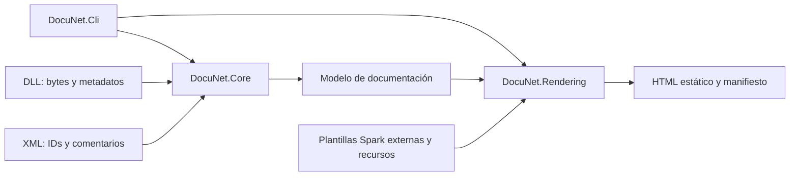

# Arquitectura y contrato de plantillas

## Componentes

Core usa PEReader y MetadataReader y decodifica firmas ECMA-335. Mantiene ID XML exacto del miembro declarado, identidad por tipo propietario y referencias para miembros heredados. Lee atributos como blobs de metadatos. XML se carga sin DTD ni entidades externas. No se usa Assembly.Load con entradas.

La resolución busca DLL junto a las entradas. Para ensamblados que referencian mscorlib usa metadatos de referencia de .NET Framework 4.8 distribuidos con el CLI (Microsoft.NETFramework.ReferenceAssemblies.net48 1.0.3); para .NET moderno consulta la plataforma del CLI. No ejecuta dependencias ni mezcla miembros de .NET 10 en la herencia de Framework. Una clase base no resoluble produce código 3, sin anunciar un sitio incompleto. Las entradas Framework anteriores a 4.8 se resuelven contra 4.8; las entradas modernas anteriores a .NET 10 usan referencias de .NET 10. La superficie heredada puede variar frente al runtime original; las firmas declaradas se obtienen siempre de la entrada. Métodos especiales y constructores no se documentan, conforme al original. Campos públicos de enum, incluido value__, sí se conservan.

Rendering no recibe objetos Reflection del target. Recibe DTO de Core, interpreta nombres de plantillas y genera en un staging nuevo. Solo tras terminar el render y validar el plan reemplaza archivos administrados sin cambios manuales. El manifiesto se escribe al terminar; un fallo del sistema de archivos durante la copia final se comunica como error y requiere revisar esa salida antes de regenerar. No se promete una transacción atómica de múltiples archivos frente a interrupciones del sistema.

## Plantillas externas

Motor: Spark 1.8.2.4-alpha con Roslyn en .NET 10. Dependencias fijadas en packages.lock.json; no se usa el Spark Framework original. Cada generación usa un motor nuevo para observar cambios de plantillas/parciales.

| Ruta | Expansión |
| --- | --- |
| index.htm.spark | index.htm |
| !namespace/index.htm.spark | namespace/index.htm |
| !namespace/!type.htm.spark | namespace/Type.Name.htm |
| !type.htm.spark | namespace.Type.Name.htm |
| !type/index.htm.spark | namespace.Type.Name/index.htm |
| !namespace/!type/index.htm.spark | namespace/namespace.Type.Name/index.htm |
| _partial.spark | Parcial; no genera archivo independiente |
| layouts/ | No genera páginas independientes |

Las carpetas especiales se reconocen por nombre exacto; en el archivo se admite prefijo !namespace o !type. Se conservan nombres históricos cortos donde son inequívocos; colisiones de tipos anidados se distinguen por su cadena de tipos propietarios.

Contexto: Assemblies, Namespaces, Types, Namespace y Type actuales, ViewData y RelativeOutputPath. Helpers conservados: h, Format de comentario/referencia, SiteResource, OutputMethodParams, WriteInterfaces, WriteProductName, WriteFileDescription, WriteAssemblyTitle, WriteVersion y Set*UrlFormat. Las firmas de los helpers reciben DTO, no System.Reflection.Assembly/Type/MethodInfo. Personalizaciones que usaban esas APIs requieren adaptar su acceso a datos.

Los parsers reconocen texto, c/code, para, paramref, see cref y listas definition/number/bullet/table. Los generadores leen summary, remarks, example, returns, value y param. No se expande inheritdoc/inheriteddoc ni se corrige sumary. Texto de XML se codifica para HTML; h codifica texto y Format genera marcado seguro.

La sintaxis Spark es código de personalización confiable: puede ejecutar C# de quien edita las plantillas. La garantía de no ejecutar ensamblados se aplica a las DLL de documentación, no a plantillas C# arbitrarias del usuario.

### Personalizar

Copie Templates, edite index.htm.spark, _common_footer.spark o main.css y ejecute el CLI con --templates apuntando a la copia. Agregue recursos no Spark para copiarlos conservando el árbol. Los archivos/rutas con atributo Hidden se omiten como recursos; los symlinks/reparse points se rechazan. Un error de plantilla produce código 4 y conserva el sitio previo.

Cambio respecto de las plantillas históricas: use `id="${Anchor(method)}"` (y property/field/ev) para cada bloque de miembro. Los helpers Format usan la misma ancla derivada del ID completo. Añada `LegacyAnchor(member)` solo cuando no esté vacío para compatibilidad de enlaces antiguos inequívocos; las plantillas suministradas ya incluyen esa adaptación. Mantener id basado solo en Name conserva la ambigüedad histórica y no cumple el contrato aprobado.

Se retiró el script HTTP condicional de IE antiguo. CSS y los cuatro recursos JavaScript distribuidos se preservan; la plantilla de footer sigue editable.

## Validación

La suite normal usa src/tests/DocuNet.TestFixtures y directorios aislados. Sus módulos y atributos lanzan excepciones si se ejecutan, permitiendo comprobar que el lector trabaja solo con metadatos. Las pruebas verifican contenido, enlaces, regeneración y protección de archivos.

Para comparar sitios adicionales, SampleValidationTests admite las variables DOCUNET_BASELINE, DOCUNET_GENERATED, DOCUNET_VALIDATION_RESULTS y DOCUNET_ACCEPTED_DIFFERENCES. Esta integración es explícita y necesita sus propias entradas y reglas; no forma parte de la suite pública normal.

Los comandos generales y los umbrales se describen en [pruebas y cobertura](testing.md). La validación visual y de accesibilidad debe acompañar cambios en la presentación.

## Créditos y avisos distribuidos

El footer identifica a DocuNet y reconoce a Docu de James Gregory como inspiración. THIRD-PARTY-NOTICES.txt se copia como recurso del sitio y se enlaza mediante SiteResource, por lo que funciona también en páginas anidadas. Conserve los avisos originales de los JS y el archivo de licencias del sitio al personalizar las plantillas.

Al distribuir el CLI, incluya su licencia y [avisos de terceros](../THIRD-PARTY-NOTICES.md), junto con los textos bajo docs/licenses. No confunda dependencias del ejecutable con recursos del sitio estático.
