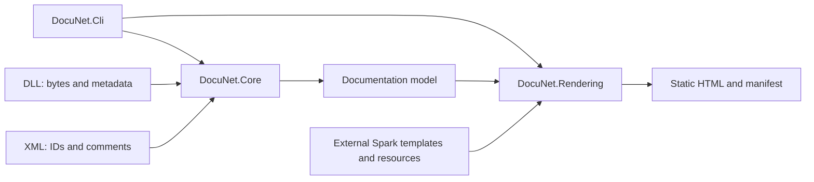

# Architecture and template contract

## Components

Core uses PEReader and MetadataReader and decodes ECMA-335 signatures. It preserves each declared member's exact XML ID, identity by declaring type and references for inherited members. Attributes are read as metadata blobs. XML is loaded without DTDs or external entities. Assembly.Load is not used with inputs.

Resolution searches for DLLs alongside inputs. For assemblies referencing mscorlib, it uses .NET Framework 4.8 reference metadata distributed with the CLI (Microsoft.NETFramework.ReferenceAssemblies.net48 1.0.3); for modern .NET it consults the CLI's platform. It does not execute dependencies or mix .NET 10 members into Framework inheritance. An unresolvable base class produces exit code 3 rather than reporting an incomplete site as successful. Framework inputs older than 4.8 are resolved against 4.8; modern inputs older than .NET 10 use .NET 10 references. The inherited API surface may differ from the original runtime; declared signatures always come from the input. Special methods and constructors are not documented, matching the original behavior. Public enum fields, including value__, are preserved.

Rendering does not receive Reflection objects from the target. It receives Core DTOs, interprets template names and generates output in a new staging directory. Only after rendering finishes and the plan is validated does it replace unchanged managed files. The manifest is written at the end; a filesystem failure during the final copy is reported as an error and requires reviewing that output before regenerating. An atomic multi-file transaction against system interruptions is not guaranteed.

## External templates

Engine: Spark 1.8.2.4-alpha with Roslyn on .NET 10. Dependencies are locked in packages.lock.json; the original Framework Spark package is not used. Each generation uses a new engine so template/partial changes are picked up.

| Path | Expansion |
| --- | --- |
| index.htm.spark | index.htm |
| !namespace/index.htm.spark | namespace/index.htm |
| !namespace/!type.htm.spark | namespace/Type.Name.htm |
| !type.htm.spark | namespace.Type.Name.htm |
| !type/index.htm.spark | namespace.Type.Name/index.htm |
| !namespace/!type/index.htm.spark | namespace/namespace.Type.Name/index.htm |
| _partial.spark | Partial; does not generate a standalone file |
| layouts/ | Does not generate standalone pages |

Special folders are recognized by exact name; filenames support the !namespace or !type prefix. Historical short names are preserved where unambiguous; nested type collisions are distinguished by their chain of declaring types.

Context: Assemblies, Namespaces, Types, the current Namespace and Type, ViewData and RelativeOutputPath. Preserved helpers: h, comment/reference Format, SiteResource, OutputMethodParams, WriteInterfaces, WriteProductName, WriteFileDescription, WriteAssemblyTitle, WriteVersion and Set*UrlFormat. Helper signatures accept DTOs rather than System.Reflection.Assembly/Type/MethodInfo. Customizations using those APIs must adapt their data access.

Parsers recognize text, c/code, para, paramref, see cref and definition/number/bullet/table lists. Generators read summary, remarks, example, returns, value and param. inheritdoc/inheriteddoc is not expanded, and sumary is not corrected. XML text is HTML-encoded; h encodes text and Format generates safe markup.

Spark syntax is trusted customization code: it can execute C# supplied by the template author. The guarantee of not executing assemblies applies to documentation input DLLs, not arbitrary user C# templates.

### Customization

Copy Templates, edit index.htm.spark, _common_footer.spark or main.css and run the CLI with --templates pointing to the copy. Add non-Spark resources to copy them while preserving the directory tree. Files/paths with the Hidden attribute are omitted as resources; symlinks/reparse points are rejected. A template error produces exit code 4 and preserves the previous site.

Change from historical templates: use `id="${Anchor(method)}"` (and property/field/ev) for each member block. Format helpers use the same anchor derived from the full ID. Add `LegacyAnchor(member)` only when nonempty for compatibility with unambiguous old links; the supplied templates already include this adaptation. Keeping an id based only on Name preserves historical ambiguity and does not meet the approved contract.

The old conditional HTTP script for IE was removed. CSS and the four distributed JavaScript resources are preserved; the footer template remains editable.

## Validation

The normal suite uses src/tests/DocuNet.TestFixtures and isolated directories. Its modules and attributes throw exceptions if executed, allowing tests to verify that the reader uses metadata only. Tests verify content, links, regeneration and file protection.

To compare additional sites, SampleValidationTests accepts DOCUNET_BASELINE, DOCUNET_GENERATED, DOCUNET_VALIDATION_RESULTS and DOCUNET_ACCEPTED_DIFFERENCES environment variables. This integration is explicit and requires its own inputs and rules; it is not part of the normal public suite.

General commands and thresholds are described in [testing and coverage](testing.md). Visual and accessibility validation must accompany presentation changes.

## Credits and distributed notices

The footer identifies DocuNet and acknowledges James Gregory's Docu as inspiration. THIRD-PARTY-NOTICES.txt is copied as a site resource and linked through SiteResource, so it also works on nested pages. Preserve original JavaScript notices and the site's license file when customizing templates.

When distributing the CLI, include its license and [third-party notices](../THIRD-PARTY-NOTICES.md), along with the texts under docs/licenses. Distinguish executable dependencies from static site resources.
